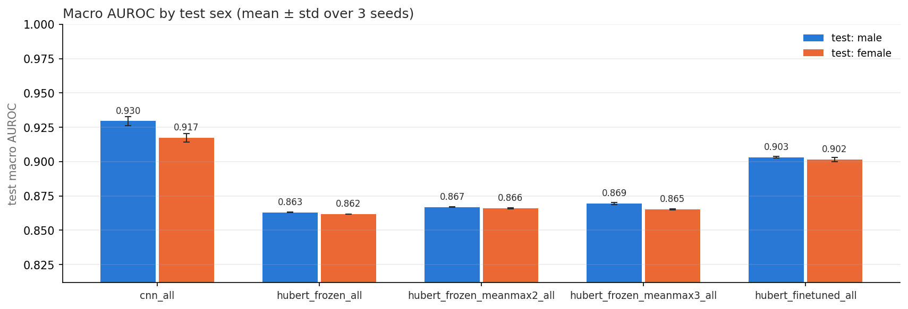
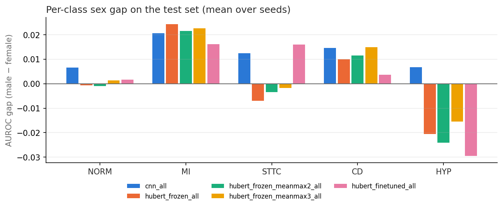

# Check-in 3 — DSAN 6600

**Sex-Matched vs. More Data: What Closes the Subgroup Gap in ECG Classification?**

Chloe Jones · Olivia Semien

> Check-in 1: [`check-in-1.md`](check-in-1.md) · Check-in 2: [`Check-in 2.md`](Check-in%202.md)

**Short version (HuBERT extension):** Fine-tuning a self-supervised ECG foundation model (HuBERT-ECG, pretrained on 9.1M ECGs) did **not** beat our Check-in 2 CNN: macro AUROC 0.903 vs 0.924. The male–female gap shrank (0.012 → 0.002), but mostly because the model got worse for men, not better for women. Most of the loss is in hypertrophy (HYP), and the evidence points to the model's required per-ECG amplitude scaling, which erases the voltage information HYP is diagnosed from. The MI gap from Check-in 2 shows up again in every model.

**Short version (improved baseline, Olivia):** [TBD: one or two sentences, see Section 4]

---

## 1. The extension

**Transfer learning from a self-supervised ECG foundation model.** Check-in 2 asked whether *more data* closes the male–female gap within PTB-XL. Pretraining is more data borrowed from outside PTB-XL: HuBERT-ECG (Coppola et al.) was pretrained with self-supervision on 9.1 million unlabeled 12-lead ECGs from four countries. We use the SMALL model (8 transformer layers, hidden size 512) and compare it to our Check-in 2 CNN.

| Model | What trains | Name |
|---|---|---|
| CNN from scratch (Check-in 2 baseline) | everything | `cnn_all` (1D ResNet, ~1.2M params) |
| Frozen encoder (linear probe) | new 5-class linear head on mean-pooled HuBERT embeddings; each 5 s half predicted separately, probabilities averaged | `hubert_frozen_all` |
| Frozen, pooled halves | same, but the two halves' embeddings are pooled (mean + max) before the head | `hubert_frozen_meanmax2_all` |
| Frozen, pooled + overlap window | same, plus a 2.5–7.5 s window so nothing near the 5 s mark is split | `hubert_frozen_meanmax3_all` |
| Fine-tuned encoder | all 8 transformer layers + head (conv feature extractor frozen) | `hubert_finetuned_all` |

All models train on the same `all` group (folds 1–7, both sexes, 14,010 ECGs).

Notebook: [`notebooks/05_hubert_transfer_mean.ipynb`](notebooks/05_hubert_transfer_mean.ipynb) (training and comparison, run on a Colab T4). Results: `hubert_results/`.

### Input pipeline
A pretrained encoder expects inputs that look like its pretraining data, so we use the authors' preprocessing instead of our CNN's z-score: 0.05–47 Hz FIR bandpass → resample to 500 Hz → per-lead min-max to [−1, 1] → 5 s windows, each flattened and decimated to 6,000 samples. We checked our implementation against the authors' pipeline (max difference < 1e-7). Each record is processed on its own, so no statistics are shared across records or sexes.

### Training
Fine-tuning follows the paper's PTB-XL recipe (AdamW, encoder LR 1e-5, weight decay 0.01, conv extractor frozen, layerdrop and dropout off), with two deliberate changes:
- The randomly initialized head gets LR 1e-3.
- The loss is **unweighted**, like the CNN's. Positive-class weights would distort the calibration-by-sex comparison.

We also turned off the encoder's pretraining-time masking, which the Hugging Face version otherwise applies during training. Checkpoint selection, LR schedule and early stopping use validation macro AUROC, as for the CNN. Training randomly picks one 5 s half per ECG; evaluation averages over both halves. Budget: max 20 epochs, patience 5, about 32 s/epoch on a T4. The frozen variants train a linear head on cached embeddings in seconds.

---

## 2. Comparison (same protocol as Check-in 2)

Same splits (train folds 1–7, val fold 8, test folds 9–10), same labels, same test records (2,137 male / 1,842 female; the notebook checks this against the saved CNN predictions), same metrics, 3 seeds per model. Values are mean ± std over seeds.

### Macro AUROC and AUPRC by test sex

| Model | AUROC all | Male | Female | Gap (M − F) | AUPRC female |
|---|---|---|---|---|---|
| `cnn_all` | **0.924** ± 0.003 | **0.930** ± 0.003 | **0.917** ± 0.003 | 0.012 ± 0.001 | **0.801** |
| `hubert_frozen_all` | 0.863 ± 0.000 | 0.863 | 0.862 | 0.001 | 0.675 |
| `hubert_frozen_meanmax2_all` | 0.867 ± 0.000 | 0.867 | 0.866 | 0.001 | 0.681 |
| `hubert_frozen_meanmax3_all` | 0.868 ± 0.001 | 0.869 | 0.865 | 0.004 | 0.682 |
| `hubert_finetuned_all` | 0.903 ± 0.001 | 0.903 ± 0.001 | 0.902 ± 0.002 | 0.002 ± 0.002 | 0.748 |

**Extension vs baseline** (`hubert_finetuned_all` − `cnn_all`, difference of seed means): male −0.026, female −0.016, gap −0.011. Both drops are several times the seed-to-seed spread (std ≤ 0.003). The gap is smaller because men lost more than women did.

### Ablations (one change each; difference of seed means)

| Comparison | What changes | Male | Female | Gap |
|---|---|---|---|---|
| frozen → fine-tuned | encoder weights update on PTB-XL | **+0.040** | **+0.040** | +0.000 |
| frozen → meanmax2 | average probabilities → learned mean + max pooling | +0.004 | +0.004 | −0.000 |
| meanmax2 → meanmax3 | + overlapping 2.5–7.5 s window | +0.003 | −0.001 | +0.003 |

The frozen variants vary very little across seeds (std ≤ 0.001), so even the small pooling gains are consistent from seed to seed.

### Per-class AUROC gap (male − female, mean over seeds)

| Class | `cnn_all` | frozen | meanmax2 | meanmax3 | fine-tuned |
|---|---|---|---|---|---|
| NORM | 0.007 | −0.001 | −0.001 | 0.001 | 0.002 |
| MI | 0.021 | 0.024 | 0.022 | 0.023 | 0.016 |
| STTC | 0.012 | −0.007 | −0.003 | −0.002 | 0.016 |
| CD | 0.015 | 0.010 | 0.011 | 0.015 | 0.004 |
| HYP | 0.007 | −0.020 | −0.024 | −0.016 | −0.030 |

### HYP: where the extension loses most

| | `cnn_all` | frozen | meanmax3 | fine-tuned |
|---|---|---|---|---|
| AUROC male / female | 0.902 / 0.895 | 0.780 / 0.800 | 0.789 / 0.805 | 0.819 / 0.848 |
| Miss rate male / female (seed 0) | 0.53 / 0.55 | 0.92 / 0.90 | 0.85 / 0.84 | 0.84 / 0.81 |

### Miss rates in women at a 0.5 cutoff (seed 0)

| Class | `cnn_all` | `hubert_finetuned_all` |
|---|---|---|
| MI | 0.374 | 0.391 |
| STTC | 0.390 | 0.398 |
| CD | 0.327 | 0.392 |
| HYP | 0.545 | 0.812 |

Miss rates come from a single seed and move noticeably between seeds, so read them as rough.

---

## 3. What got better or worse, and why

**Worse overall.** The best HuBERT model (fine-tuned) is 2 AUROC points below the CNN, and the frozen variants are about 6 points below. It isn't undertrained: fine-tuned validation loss bottomed out at epochs 10–13 and then rose while training loss kept falling, best validation AUROC came at epochs 13–15, and 2 of 3 seeds early-stopped.

**Main cause: amplitude scaling erases voltage (supported by the per-class results).** HuBERT's required preprocessing min-max scales every lead of every ECG to [−1, 1], so a very tall QRS and a normal one look the same. Our CNN z-scores with training-set statistics and keeps absolute voltage. Hypertrophy is diagnosed largely from QRS voltage, and HYP is exactly where HuBERT collapses: AUROC 0.90 → 0.82–0.85, miss rate about 54% → over 80% (seed 0). Changing which time windows the model sees (meanmax2/3) left HYP essentially unchanged, so HYP's problem is not time coverage. The other classes lose less (NORM about −0.02, MI/CD −0.01 to −0.02, STTC near zero), so the rest of the gap likely comes from the other differences: 5 s inputs vs the CNN's full 10 s, leads concatenated end to end instead of seen side by side, and a pretraining mix that differs from PTB-XL.

**Why the model is built this way:** pretraining on 9.1M ECGs from ~11 datasets recorded on different devices needs inputs on a common scale, and the architecture is reused from speech, where loudness is irrelevant. Those choices help pretrain at scale but remove information that a specific diagnosis needs.

**The gap "closed" by leveling down.** The male–female gap dropped from 0.012 to 0.002, but men lost 0.026 AUROC while women lost 0.016. Part of the shrinkage is HYP flipping to favor women under the new preprocessing. That is not a fairness improvement.

**Fine-tuning helps both sexes equally.** Adapting the encoder to PTB-XL adds 0.040 AUROC for men and women alike, with no change in the gap. The pretrained representation alone (frozen) carries most of the signal, but not all of it.

**Time windows matter little.** Learned pooling of the two halves beats averaging probabilities by a small but consistent 0.004. Adding an overlapping middle window adds 0.003 for men and nothing for women. Most of our five classes show up in every beat, so splitting the ECG at 5 s was not what held the model back.

**The MI gap is robust.** MI is 0.016–0.024 worse for women in every model: the CNN, three frozen variants and the fine-tuned transformer. The frozen encoder never saw our labels or our sex split and still shows it. Together with Check-in 2 (sex-matched training didn't close it), this points to the MI gap coming from the signals or the labels rather than from training-set composition or architecture.

---

## 4. Improving the CNN baseline (Olivia)

<!-- TODO (Olivia): fill in every [TBD]. Keep the Check-in 2 protocol so the numbers line up with the tables above:
     train folds 1-7, val fold 8, test folds 9-10, training group "all", seeds 0-2, checkpoint selection on validation macro AUROC,
     test on both sexes. Save predictions in the same CSV format as cnn_results/ (EVAL.md) so the comparison
     tables can include the new model. -->

**What changed:** [TBD: one or two sentences, e.g. architecture, augmentation, loss, input, training schedule]

**Why:** [TBD: what weakness in `cnn_all` this targets, e.g. the female MI misses or HYP]

Notebook: [`notebooks/[TBD].ipynb`](notebooks/) · Results: `[TBD]_results/`

### Results (same test set, mean ± std over 3 seeds)

| Model | AUROC all | Male | Female | Gap (M − F) | AUPRC female |
|---|---|---|---|---|---|
| `cnn_all` (Check-in 2) | 0.924 ± 0.003 | 0.930 ± 0.003 | 0.917 ± 0.003 | 0.012 ± 0.001 | 0.801 |
| `[TBD]` | [TBD] | [TBD] | [TBD] | [TBD] | [TBD] |
| `hubert_finetuned_all` | 0.903 ± 0.001 | 0.903 ± 0.001 | 0.902 ± 0.002 | 0.002 ± 0.002 | 0.748 |

**Difference vs `cnn_all`** (difference of seed means): male [TBD], female [TBD], gap [TBD].

### Per-class gap (mean over seeds) and female miss rates (seed 0)

| Class | Gap: `cnn_all` | Gap: `[TBD]` | Female miss: `cnn_all` | Female miss: `[TBD]` |
|---|---|---|---|---|
| NORM | 0.007 | [TBD] | 0.061 | [TBD] |
| MI | 0.021 | [TBD] | 0.374 | [TBD] |
| STTC | 0.012 | [TBD] | 0.390 | [TBD] |
| CD | 0.015 | [TBD] | 0.327 | [TBD] |
| HYP | 0.007 | [TBD] | 0.545 | [TBD] |

### Ablation

[TBD: what single change was tested, and its effect. Example: the new model with vs without the change, everything else fixed.]

### What got better or worse, and why

[TBD: did it help overall? Did it help women more than men (gap), or level down? Any class-specific changes, especially MI and HYP?]

---

## 5. Remaining limitations

- **Amplitude explanation is supported, not proven.** A direct test would restore each lead's original amplitude range as extra inputs to the frozen probe and check whether HYP recovers.
- **Not a pure architecture comparison.** The CNN and HuBERT differ in architecture, size (~1.2M vs tens of millions of parameters), preprocessing and training budget at once. The ablations isolate single changes within HuBERT; an optional from-scratch HuBERT control (`RUN_SCRATCH = True` in the notebook) was not run.
- **Pretraining overlap with our test set.** HuBERT-ECG's pretraining data includes PTB-XL with labels removed, and the paper doesn't say test folds were held out, so the encoder has likely seen our test ECGs (never their labels). This could only have helped HuBERT, which still underperformed.
- **Only the `all` training group** was run for HuBERT, so we haven't tested whether pretraining changes the sex-matched vs mixed result from Check-in 2.
- **Shorter training budget** than the paper (about 20 epochs vs 70k steps), although validation had already peaked.
- **Check-in 2 limitations still apply:** labels are expert reads that may under-diagnose women (HYP), and device effects haven't been checked against the gap.

---

## 6. Video

~5 min, linked [HERE]([TBD])

---

## 7. AI Disclosure

We used AI as an assistant on this check-in, specifically for:

- **Code** 
- **Research** 
- **Analysis and writing**

**Credit to the HuBERT-ECG authors:** the pretrained model (architecture and weights) is theirs, loaded from Hugging Face. Our preprocessing re-implements theirs, and our fine-tuning settings (learning rate, optimizer, frozen conv layers, dropout/layerdrop off) follow their released PTB-XL scripts, both from https://github.com/Edoar-do/HuBERT-ECG. The training loop, classification wrapper and comparison analysis are our own, adapted from our Check-in 2 CNN notebook.

All code was run by us on the real data, and all numbers come from our notebook outputs. We reviewed and edited the AI-assisted code and text, and we are responsible for the final content.

---

## 8. References

Coppola, E., Savardi, M., Massussi, M., Adamo, M., Metra, M., & Signoroni, A. (2024). HuBERT-ECG as a self-supervised foundation model for broad and scalable cardiac applications. *medRxiv*. https://doi.org/10.1101/2024.11.14.24317328

Hsu, W.-N., Bolte, B., Tsai, Y.-H. H., Lakhotia, K., Salakhutdinov, R., & Mohamed, A. (2021). HuBERT: Self-supervised speech representation learning by masked prediction of hidden units. *IEEE/ACM TASLP*, 29, 3451–3460. https://doi.org/10.1109/TASLP.2021.3122291

Wagner, P., Strodthoff, N., Bousseljot, R.-D., Kreiseler, D., Lunze, F. I., Samek, W., & Schaeffter, T. (2020). PTB-XL, a large publicly available electrocardiography dataset. *Scientific Data*. https://doi.org/10.1038/s41597-020-0495-6

Strodthoff, N., Wagner, P., Schaeffter, T., & Samek, W. (2021). Deep learning for ECG analysis: Benchmarks and insights from PTB-XL. *IEEE JBHI*, 25(5), 1519–1528. https://doi.org/10.1109/JBHI.2020.3022989
