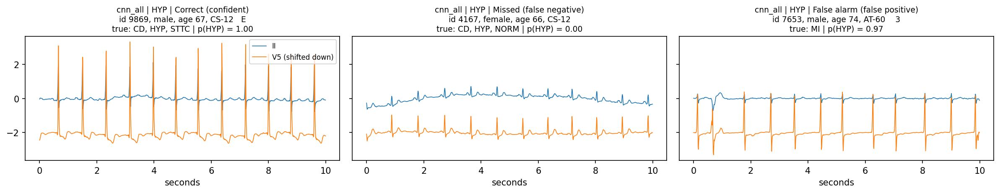
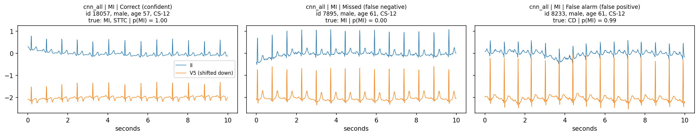
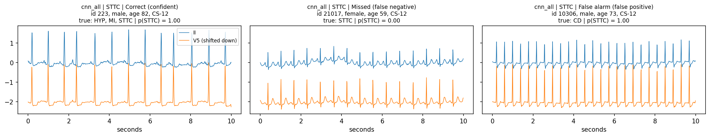
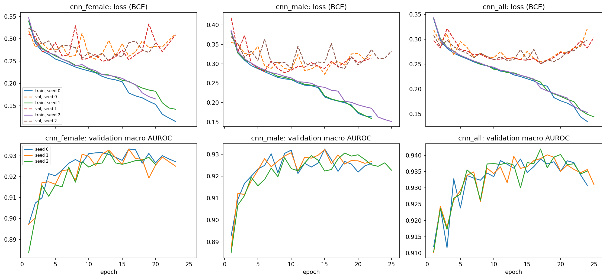

# Check-in 2 — DSAN 6600

**Sex-Matched vs. More Data: What Closes the Subgroup Gap in ECG Classification?**

Chloe Jones · Olivia Semien · Due Oct 28, 2026

> Check-in 1 (problem framing, dataset, EDA, evaluation plan) now lives in [`check-in-1.md`](check-in-1.md).

---

## 1. What's new in this check-in

We built the neural baseline: a 1D residual CNN over the raw 12-lead ECG, trained three ways with the architecture held fixed and only the training population changing.

| Model | Trains on | Validates on | Train records |
|---|---|---|---|
| `cnn_female` | female records, folds 1–7 | female, fold 8 | 6,566 |
| `cnn_male` | male records, folds 1–7 | male, fold 8 | 7,444 |
| `cnn_all` | all records, folds 1–7 | all, fold 8 | 14,010 |

Each model is trained with 3 seeds (9 runs total) and every model is tested on **both** the male and female test sets (folds 9–10), giving a 3 × 2 grid. This grid is a first look at two of our questions: is sex-matched training data better for women than mixed data, and does more data close the male–female gap?

Notebook: [`notebooks/03_cnn_baseline.ipynb`](notebooks/03_cnn_baseline.ipynb)

---

## 2. Model

ResNet-style 1D CNN, ~1.2M parameters.

```
input (12 leads × 1,000 samples, 10 s @ 100 Hz)
  → per-lead z-score (stats stored in the model)
  → stem: Conv1d(k=15, stride 2, 64 ch) + BN + ReLU + MaxPool
  → ResBlock 64→64
  → ResBlock 64→128   (stride 2)
  → ResBlock 128→128
  → ResBlock 128→256  (stride 2)
  → global average pool → dropout(0.2) → Linear(256 → 5)
  → 5 independent sigmoids (NORM, MI, STTC, CD, HYP)
```

Each residual block is two `k=7` convolutions with batch norm, ReLU and dropout, plus a 1×1 projection shortcut when the shape changes. This is the standard model family for PTB-XL and is small enough to train each run in minutes on a Colab T4.

**The architecture is fixed for the rest of the project.** Training size and composition are the independent variables; changing the model would confound them.

---

## 3. Training setup

| | |
|---|---|
| **Splits** | train = folds 1–7, validation = fold 8, test = folds 9–10. Patients never cross folds. Train/val are filtered to the model's group; test always includes both sexes. |
| **Normalization** | Per-lead z-score using mean/std from **that model's own training records only**, so the female-only model never sees statistics computed from male data. |
| **Loss** | `BCEWithLogitsLoss`, unweighted |
| **Optimizer** | AdamW, lr 1e-3, weight decay 1e-4, batch 64 |
| **Schedule** | ReduceLROnPlateau on validation macro AUROC (factor 0.5, patience 3) |
| **Stopping** | max 40 epochs; early stop after 7 epochs with no validation improvement; keep the best-validation-AUROC checkpoint |
| **Seeds** | 0, 1, 2 — each changes weight init and batch order |

**Size confound.** `cnn_all` trains on roughly twice as many records as either single-sex model, so comparing it to them mixes *more data* with *mixed data*. The notebook has a `MATCH_SIZE` switch that subsamples every group to the female training size (6,566) to separate the two; this is the first step of the training-size ladder (§7).

---

## 4. Results

All numbers are on the held-out test set, mean ± std over 3 seeds.

### Macro AUROC: training group × test sex

| Model | Test: male | Test: female | Gap (M − F) |
|---|---|---|---|
| `cnn_female` | 0.913 ± 0.005 | 0.905 ± 0.000 | 0.008 ± 0.002 |
| `cnn_male` | 0.924 ± 0.005 | 0.907 ± 0.001 | 0.017 ± 0.001 |
| `cnn_all` | **0.930** ± 0.003 | **0.917** ± 0.003 | 0.012 ± 0.001 |

### Macro AUPRC

| Model | All | Male | Female |
|---|---|---|---|
| `cnn_female` | 0.784 | 0.785 | 0.779 |
| `cnn_male` | 0.795 | 0.809 | 0.778 |
| `cnn_all` | 0.813 | 0.823 | 0.801 |

### What the results say

- **The combined model is best for everyone.** `cnn_all` beats both single-sex models on both test sets, including beating the female-only model on women by about 0.012 AUROC. At these sizes, more data wins over sex-matched data. Because `cnn_all` also has twice the data, this doesn't yet tell us whether *mixing* helps or only *size* helps — the training-size ladder (§7) will separate the two.
- **Sex-matching didn't help women at this size.** On the female test set, `cnn_female` (0.905) and `cnn_male` (0.907) are effectively tied. A model that never saw a female ECG does as well on women as one trained only on women. The male training set is ~13% larger, which may account for its small edge.
- **Every model scores higher on men — even the female-only one.** `cnn_female` is still 0.008 better on men than women. So the gap isn't only about who is in the training data; part of it comes from the female test set being harder for this task (different base rates, lower chest-lead voltage, labels built on male-derived criteria — see Check-in 1 EDA).
- **Training composition does change the size of the gap.** The gap is smallest for the female-only model (0.008), largest for the male-only model (0.017), and in between for the combined model (0.012). Seed variance is small (std ≤ 0.006 on every AUROC), so differences of ~0.01 are consistent across seeds; differences of ~0.002 are not meaningful.

---

## 5. Failure analysis

### Per-class AUROC gap (male − female, mean over seeds)

| Class | `cnn_female` | `cnn_male` | `cnn_all` |
|---|---|---|---|
| NORM | 0.006 | 0.011 | 0.007 |
| MI | **0.029** | **0.030** | **0.021** |
| STTC | 0.008 | 0.022 | 0.012 |
| CD | 0.003 | 0.021 | 0.015 |
| HYP | −0.007 | 0.001 | 0.007 |

- **MI label has the largest gap, and it survives sex-matching.** Every model is 0.02–0.03 AUROC worse on women for MI, including the female-only model. Training on women alone doesn't fix it, which points toward something about the female MI signal or labels rather than training composition. 

- **STTC and CD gaps are driven by training composition.** The male-only model has a ~0.02 gap on both; the female-only model nearly eliminates it (0.008 and 0.003). For these classes, sex-matched data does matter.
- **HYP is the hardest class for both sexes**, and the female-only model actually does slightly better on women than men (−0.007).

### Miss rates at a 0.5 cutoff (`cnn_all`, seed 0)

The 0.5 cutoff is only for counting errors; the reported metrics are threshold-free.

| Class | Miss rate, male | Miss rate, female | False-alarm rate, male | False-alarm rate, female |
|---|---|---|---|---|
| NORM | 0.089 | 0.061 | 0.152 | **0.223** |
| MI | 0.268 | **0.374** | 0.077 | 0.065 |
| STTC | 0.336 | **0.390** | 0.046 | 0.046 |
| CD | 0.263 | **0.327** | 0.052 | 0.046 |
| HYP | 0.527 | 0.545 | 0.029 | 0.018 |

The errors run in one direction: women's disease is missed more often (MI 37% vs 27%, CD 33% vs 26%, STTC 39% vs 34%), and women's abnormal ECGs are called **normal** more often (22% vs 15%). At a fixed threshold the model under-calls disease in women.

### Qualitative examples

For MI, STTC and HYP we plotted, from `cnn_all`, a confident correct case, the worst miss and the worst false alarm (lead II and V5, raw mV).



The worst HYP miss is a 66-year-old woman with low-amplitude V5 complexes; the model gives p(HYP) ≈ 0. The confident correct HYP case is a man with very tall V5 R waves. This matches the Check-in 1 EDA, where only 49% of women diagnosed with HYP met the Sokolow-Lyon voltage threshold vs 62% of men: a model that leans on voltage will miss low-voltage female hypertrophy. The worst STTC miss is also a woman. The worst MI miss is a man, so we don't want to over-read single examples; the miss-rate table above is the stronger evidence.




---

## 6. Training behavior



- Validation macro AUROC climbs fast and plateaus by roughly epoch 10–15 (~0.93 for single-sex models, ~0.94 for the combined model). All runs early-stopped between epochs 20 and 25.
- **Validation loss bottoms out around epoch 8–15 and then rises** while training loss keeps falling — the model is overfitting and becoming overconfident, even though ranking (AUROC) holds steady. Because we select checkpoints on validation AUROC, the saved model may sit past the loss minimum, which can hurt calibration. We'll check this directly with the ECE/reliability curves, and may switch checkpoint selection to validation loss if calibration is poor.
- The three seeds track closely in every panel, consistent with the small seed variance in the results.

---

## 7. Limitations and next steps

**Limitations of this baseline.**
- `cnn_all` vs. the single-sex models confounds size and composition (§3).
- Labels are expert ECG reads, not ground truth; if the labels under-diagnose women (e.g., HYP), our test set can't see it.
- The device confound from Check-in 1 (CS100 records 37% of men vs 21% of women) hasn't been checked against the gap yet.
- Validation-loss overfitting may affect calibration (§6).
- The unweighted loss is conservative on rare classes: at a 0.5 cutoff, HYP is missed over half the time and MI, STTC and CD are missed more often in women (§5).

**Next.**
1. **Training-size ladder** (the main grid): train all three groups at several sizes, from small subsets up to 6,566 records (the full female training set), 3 seeds each. Every model is subsampled to the same N, which separates "more data" from "mixed data." Reading **across groups at a fixed N** tests whether sex-matched data is better for women than the same amount of mixed data. Reading **across sizes** and plotting the M − F gap against N tests whether more data closes the gap.
2. **Shared evaluation:** calibration (ECE, reliability curves by sex), age-band and device slices, and comparison against the logistic regression floor.
3. **Recalibration on women only**, focused on MI, to test representation vs. threshold.
4. **Recall-focused loss.** In a clinical screening setting, a missed diagnosis costs more than a false alarm, and our errors concentrate in missed disease in women. We will train a variant that penalizes misses more heavily:
   - **Positive-class weights** (`pos_weight` in `BCEWithLogitsLoss`) to raise the cost of false negatives, especially for rare classes like HYP.
   - **Focal loss**, which down-weights easy, already-correct examples so training concentrates on hard cases and confident misses (true positives the model scores near 0, like the low-voltage female HYP case in §5).

   This runs as a **separate arm** rather than replacing the baseline. Weighting inflates predicted probabilities, which would distort the calibration-by-sex comparison. So the unweighted model stays the reference for the main grid, and we compare the two on recall/sensitivity by sex, confident-miss counts, AUROC, and calibration. The key question is whether a recall-focused loss shrinks the female miss rate more than simply lowering the decision threshold on the unweighted model.
5. **Transfer learning.** The training-size ladder asks whether more data closes the gap within PTB-XL. Pretraining is more data, borrowed rather than collected: an encoder pretrained on large external ECG collections has seen far more patients than PTB-XL holds. If scale within PTB-XL doesn't close the gap, transfer might. We will compare three regimes on the same splits and test sets:

   | Regime | What trains |
   |---|---|
   | From scratch | Everything (the baseline in this check-in) |
   | Frozen | Pretrained encoder fixed, new 5-class head only |
   | Fine-tuned | Pretrained encoder updated end to end |

   The encoder will come from a publicly available self-supervised ECG model (most are 1D vision-transformer masked autoencoders). Like the loss arm, this is a **separate arm** run at a few sizes from the training-size ladder rather than the full grid, so it doesn't confound the main comparison. The questions are whether pretraining raises female performance, whether it shrinks the M − F gap (especially for MI, where sex-matching didn't help), and whether a frozen encoder, which never saw our sex split, carries the same gap as models trained from scratch.

---

## 8. AI Disclosure

We used AI as an assistant on this check-in. Specifically, it helped with:

- **Code:** drafting and debugging the model, training loop, Colab backup/restore logic, and evaluation code
- **Error checking:** reviewing code for bugs and data leakage (e.g., per-group normalization)
- **Writing:** drafting parts of this README, including the results summary and failure analysis, from our notebook outputs

All code was run by us on the real data, and all numbers in this document come from our notebook outputs. We reviewed and edited the AI-assisted code and text, and we are responsible for the final content.

---

## 9. References

Wagner, P., Strodthoff, N., Bousseljot, R.-D., Kreiseler, D., Lunze, F. I., Samek, W., & Schaeffter, T. (2020). PTB-XL, a large publicly available electrocardiography dataset. *Scientific Data*. https://doi.org/10.1038/s41597-020-0495-6

Wagner, P., et al. (2022). PTB-XL, a large publicly available electrocardiography dataset (version 1.0.3). *PhysioNet*. RRID:SCR_007345. https://doi.org/10.13026/kfzx-aw45

He, K., Zhang, X., Ren, S., & Sun, J. (2016). Deep residual learning for image recognition. *CVPR*. https://doi.org/10.1109/CVPR.2016.90

Strodthoff, N., Wagner, P., Schaeffter, T., & Samek, W. (2021). Deep learning for ECG analysis: Benchmarks and insights from PTB-XL. *IEEE Journal of Biomedical and Health Informatics*, 25(5), 1519–1528. https://doi.org/10.1109/JBHI.2020.3022989
