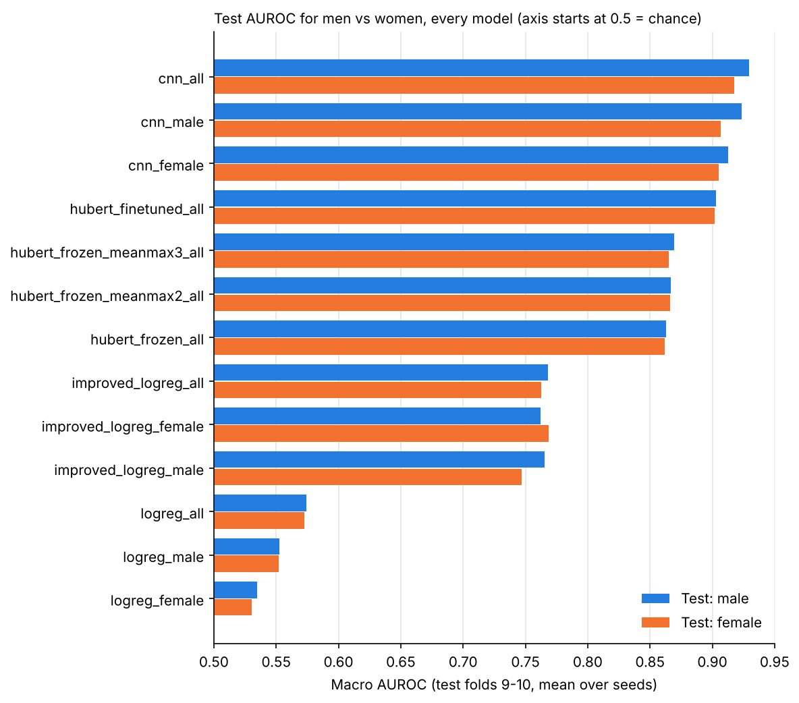

# Final Report — DSAN 6600

**Sex-Matched vs. More Data: What Closes the Subgroup Gap in ECG Classification?**

Chloe Jones · Olivia Semien · Fall 2026

This report tells the whole project in one place, from problem framing (Check-in 1) through the CNN baseline (Check-in 2) to the transfer-learning extension (Check-in 3). The check-in write-ups keep the full detail and every intermediate table: [Check-in 1](check-in-1.md) · [Check-in 2](check-in-2.md) · [Check-in 3](check-in-3.md).

**Contents:** [1 Problem](#1-problem-and-motivation) · [2 Data](#2-data) · [3 Evaluation](#3-evaluation-protocol) · [4 Models](#4-models) · [5 Results](#5-results) · [6 Failure analysis](#6-failure-analysis) · [7 Conclusions](#7-what-we-conclude) · [8 Limitations](#8-limitations) · [9 Future work](#9-future-work)

---

## Summary

We trained ECG classifiers on PTB-XL (5 diagnostic superclasses, 12-lead, 10 s) and measured them separately on men and women. Five findings:

1. **More data beat sex-matched data for women, at the sizes we tested.** The CNN trained on everyone (`cnn_all`) scores 0.917 macro AUROC on women; the female-only CNN scores 0.905, and the male-only CNN, which never saw a female ECG, scores 0.907. Because `cnn_all` also has about twice the training data, this does not separate *mixing* from *size* (see §8).
2. **Every neural model is worse for women, including the female-only one.** Gaps (male − female AUROC) range from 0.008 to 0.017 for the CNNs. Part of the gap belongs to the female test set itself, not only to who is in the training data.
3. **The MI gap survives everything we tried.** Myocardial infarction is 0.016–0.030 AUROC worse for women in the female-only CNN, the male-only CNN, the combined CNN, a frozen pretrained transformer that never saw our labels, and the fine-tuned transformer.
4. **The errors point one way: disease in women is missed.** At a 0.5 cutoff, `cnn_all` misses 37% of MI in women vs 27% in men, and calls women's abnormal ECGs normal more often (22% vs 15% false-alarm rate on NORM).
5. **A 9.1M-ECG foundation model (HuBERT-ECG) did not help.** Fine-tuned, it reaches 0.902 vs the CNN's 0.924. Its gap is smaller (0.002), but because men lost more AUROC than women did, not because women improved. The loss is concentrated in hypertrophy, which the model's required per-ECG amplitude scaling makes hard to see.

---

## 1. Problem and motivation

Heart disease in women is underdiagnosed, and many ECG criteria were derived mostly from men. If a model learns from those labels and those patients, it can perform worse for the group that is already underserved. The usual answer to a subgroup gap is "collect more data." We asked whether that is right for ECG classification, or whether *who* is in the training data matters more than *how much*.

**Task.** Multi-label classification of 12-lead ECGs into PTB-XL's five diagnostic superclasses: NORM (normal), MI (myocardial infarction), STTC (ST/T change), CD (conduction disturbance), HYP (hypertrophy).

**Questions (from Check-in 1).**
- **RQ1, trade-off:** Is female performance better served by sex-matched training data or by a mixed set?
- **RQ2, scale:** Does adding data shrink the male–female gap?
- **RQ3, mechanism:** If a gap survives, is it a different learned representation or a mis-set threshold?

**Design choice.** Hold the model fixed and vary only the training population, then score every model on the male and female test sets separately. Changing the architecture at the same time would confound the comparison.

## 2. Data

**PTB-XL v1.0.3** (PhysioNet, CC BY 4.0, no credentialing): 21,799 clinical 12-lead ECGs from 18,869 patients, 10 s each. We use the 100 Hz version (12 × 1,000 samples).

**Cleaning** ([`01_data_cleaning.ipynb`](../notebooks/01_data_cleaning.ipynb), mirrored in [`src/ptbxl.py`](../src/ptbxl.py)):
- Keep ages 20–85 (removes the privacy-coded age 300 and pediatric records): 21,799 → 20,370.
- Map SCP codes to the 5 superclasses via `scp_statements.csv`; drop the 378 records with no diagnostic label: **19,992 modeling records**.
- Splits use PTB-XL's patient-grouped `strat_fold`: train folds 1–7 (7,444 male / 6,566 female), validation fold 8 (1,061 / 942), test folds 9–10 (2,137 / 1,842). Folds 9–10 are fully human-validated.

**What the EDA showed** ([`02_eda_signals.ipynb`](../notebooks/02_eda_signals.ipynb); figures in [Check-in 1](check-in-1.md#3-data-audit--eda)):
- **Base rates differ.** 50% of women's ECGs are normal vs 39% of men's; men have more MI (30% vs 19%) and CD (26% vs 17%). Comparisons across sexes partly reflect these base rates, which is why every metric is reported per sex and per class.
- **Signals differ where diagnoses live.** In the average normal beat, women's chest-lead R waves are shorter (V4/V5 ≈ 1.05 vs 1.4 mV) and T waves lower: the ST/T region and chest-lead voltage used for MI, STTC and HYP.
- **Labels carry male-derived criteria.** Among patients *labeled* HYP, 49% of women vs 62% of men exceed the Sokolow–Lyon voltage threshold. Labels are ECG reads, not imaging, so low-voltage female hypertrophy may be under-labeled, and the test set cannot detect errors it shares.
- **Device confound.** The CS100 device recorded 37% of men but 21% of women.
- **Label quality.** Training folds are only 62–66% human-validated.

## 3. Evaluation protocol

Fixed before any model was trained, and identical for every model in this report:

- **Test set:** the same 3,979 ECGs (folds 9–10) for every model. [`src/evaluate.py`](../src/evaluate.py) asserts that every saved prediction file has the same test IDs and labels.
- **Metrics:** macro AUROC and macro AUPRC, separately on the male and female test sets (accuracy is meaningless at this class imbalance). **Gap** = male AUROC − female AUROC.
- **Per-class AUROC gap**, because a pooled average can hide a class-specific failure.
- **Miss rates** at a 0.5 cutoff, only to count errors; the headline metrics are threshold-free.
- **Seeds:** 3 per neural model (weight init and batch order). Results are mean ± std over seeds; with std ≤ 0.006 on every neural AUROC, differences around 0.01 are consistent and differences around 0.002 are not.
- **Checkpoint selection** on validation macro AUROC; the test set is never used for any choice.

## 4. Models

| Model | Stage | Input | Notebook |
|---|---|---|---|
| Logistic regression, raw time points | CI2 floor | 1,200 features (each lead downsampled to 100 points) | [`04_logistic_baseline`](../notebooks/04_logistic_baseline.ipynb) |
| Logistic regression, lead statistics | CI3 baseline improvement | 60 features (mean, std, min, max, RMS per lead) | [`06_improving_logistic_baseline`](../notebooks/06_improving_logistic_baseline.ipynb) |
| **1D ResNet CNN** | **CI2 baseline** | raw 12 × 1,000 signal, per-lead z-score from the model's own training records | [`03_cnn_baseline`](../notebooks/03_cnn_baseline.ipynb) |
| **HuBERT-ECG SMALL, frozen and fine-tuned** | **CI3 extension** | authors' preprocessing: 0.05–47 Hz bandpass → 500 Hz → per-lead min-max to [−1, 1] → two 5 s windows | [`05_hubert_transfer_mean`](../notebooks/05_hubert_transfer_mean.ipynb) |

**CNN (Check-in 2).** ResNet-style 1D CNN, ~1.2M parameters: a stride-2 stem, four residual blocks (64 → 256 channels), global average pooling, five sigmoid outputs. Unweighted BCE, AdamW (lr 1e-3), ReduceLROnPlateau, early stopping (patience 7). Trained three ways with the architecture fixed: `cnn_female`, `cnn_male`, `cnn_all`. Architecture in [`src/cnn.py`](../src/cnn.py).

**HuBERT-ECG (Check-in 3).** A transformer pretrained with self-supervision on 9.1M unlabeled ECGs (Coppola et al., 2024). Pretraining is "more data" borrowed from outside PTB-XL, which makes it a direct test of RQ2 beyond PTB-XL's size. We ran a frozen-encoder linear probe, two pooling variants of it, and full fine-tuning (paper recipe: encoder lr 1e-5, conv extractor frozen), all on the `all` training group. The loss stayed unweighted to match the CNN.

**Logistic regression.** The raw time-point version performs near chance because heartbeats fall at different positions in each recording, so a fixed time slot means nothing across patients. Replacing it with position-invariant per-lead statistics was Check-in 3's baseline improvement.

## 5. Results

### Main comparison (test set, mean ± std over seeds)

| Model | Trains on | AUROC all | Male | Female | Gap (M − F) | AUPRC female |
|---|---|---|---|---|---|---|
| `cnn_all` | all, 14,010 | **0.924** ± 0.003 | **0.930** | **0.917** | 0.012 ± 0.001 | **0.801** |
| `cnn_male` | male, 7,444 | 0.916 ± 0.001 | 0.924 | 0.907 | 0.017 ± 0.001 | 0.778 |
| `cnn_female` | female, 6,566 | 0.910 ± 0.001 | 0.913 | 0.905 | 0.008 ± 0.002 | 0.779 |
| `hubert_finetuned_all` | all | 0.902 ± 0.001 | 0.903 | 0.902 | 0.002 ± 0.002 | 0.748 |
| `hubert_frozen_meanmax3_all` | all | 0.868 ± 0.001 | 0.869 | 0.865 | 0.004 | 0.682 |
| `hubert_frozen_all` | all | 0.863 ± 0.000 | 0.863 | 0.862 | 0.001 | 0.675 |
| `improved_logreg_all` | all | 0.765 | 0.768 | 0.763 | 0.005 | 0.543 |
| `improved_logreg_female` | female | 0.764 | 0.762 | 0.769 | −0.007 | 0.544 |
| `logreg_all` | all | 0.573 | 0.574 | 0.572 | 0.002 | 0.322 |

Every row is rebuilt by [`src/evaluate.py`](../src/evaluate.py) from the saved predictions in `cnn_results/`, `hubert_results/` and `results/` (all 13 models: [`results/final/summary_by_model.csv`](../results/final/summary_by_model.csv)). The logistic models are deterministic and use no subsampling, so their three "seeds" are identical runs (std 0).

### Extension vs baseline

Fine-tuned HuBERT minus `cnn_all` (difference of seed means): **male −0.026, female −0.016, gap −0.011.** Both drops are several times the seed spread. The gap shrinks because men lose more.

| Ablation (one change each) | Male | Female | Gap |
|---|---|---|---|
| frozen → fine-tuned (encoder updates on PTB-XL) | **+0.040** | **+0.040** | +0.000 |
| frozen → pooled halves (mean + max) | +0.004 | +0.004 | −0.000 |
| pooled → + overlapping middle window | +0.003 | −0.001 | +0.003 |

Fine-tuning lifts both sexes equally; changing which time windows the model sees barely matters.

### Per-class AUROC gap (male − female, mean over seeds)

| Class | `cnn_female` | `cnn_male` | `cnn_all` | HuBERT frozen | HuBERT fine-tuned | `improved_logreg_all` |
|---|---|---|---|---|---|---|
| NORM | 0.006 | 0.011 | 0.007 | −0.001 | 0.002 | 0.007 |
| **MI** | **0.029** | **0.030** | **0.021** | **0.024** | **0.016** | 0.012 |
| STTC | 0.008 | 0.022 | 0.012 | −0.007 | 0.016 | 0.025 |
| CD | 0.003 | 0.021 | 0.015 | 0.010 | 0.004 | −0.001 |
| HYP | −0.007 | 0.001 | 0.007 | −0.020 | −0.030 | −0.015 |

### Missed disease in women at a 0.5 cutoff (seed 0)

| Class | `cnn_all` | HuBERT fine-tuned | `improved_logreg_all` |
|---|---|---|---|
| MI | 0.374 | 0.391 | 0.814 |
| STTC | 0.390 | 0.398 | 0.920 |
| CD | 0.327 | 0.392 | 0.643 |
| HYP | **0.545** | **0.812** | 0.708 |

## 6. Failure analysis

**MI: the gap is not about training composition or architecture.** Sex-matching does not close it (`cnn_female` 0.029), more data does not close it (`cnn_all` 0.021), and a frozen encoder that never saw our labels or our sex split shows it too (0.024). What is left is the signal or the labels: the EDA shows lower chest-lead voltage and flatter ST/T in women in exactly the leads used for MI. We cannot tell from PTB-XL alone whether the models miss real female MI or whether female MI labels are noisier.

**STTC and CD: composition does matter.** The male-only CNN has a ~0.02 gap on both; the female-only CNN nearly removes it (0.008 and 0.003). For these classes, having women in the training data helps women. This is the one place where the answer to RQ1 is clearly "composition."

**HYP: voltage is the mechanism.** The worst `cnn_all` HYP miss is a woman with low-amplitude V5 complexes (p ≈ 0); the confident correct case is a man with very tall V5 R waves ([Check-in 2 examples](check-in-2.md#qualitative-examples)). HuBERT makes this worse: its required per-ECG min-max scaling maps a tall QRS and a normal one to the same range, removing absolute voltage, which hypertrophy is diagnosed from. HYP is where HuBERT collapses (AUROC ≈ 0.90 → 0.82–0.85; female miss rate 55% → 81%), and window changes leave HYP unchanged. This is supported by the per-class pattern but not proven (see §8).

**A smaller gap is not always a fairer model.** HuBERT's gap of 0.002 looks like progress, but both sexes got worse and HYP flipped to favor women only because the model lost voltage information for everyone. We treat a gap reduction as an improvement only if female performance rises or holds.

**Training behavior.** CNN validation loss bottoms out around epochs 8–15 and then rises while AUROC holds: the models grow overconfident. Since checkpoints are selected on AUROC, calibration may suffer; we did not measure it (§8). HuBERT fine-tuning also peaked (validation AUROC at epochs 13–15, 2 of 3 seeds early-stopped), so its deficit is not undertraining.

## 7. What we conclude

- **RQ1 (sex-matched vs mixed).** At full PTB-XL sizes, the mixed model is best for women overall. Sex-matched data helps specific classes (STTC, CD) but not MI. Because the mixed model also has twice the data, our evidence favors "more data" without ruling out that mixing itself helps.
- **RQ2 (does scale close the gap?).** Not by itself. Doubling the data (`cnn_all`) and borrowing 9.1M pretraining ECGs (HuBERT) both leave the MI gap in place. HuBERT's overall gap shrinks, but by leveling down.
- **RQ3 (representation vs threshold).** Not tested directly (no recalibration experiment). The consistent direction of errors (missed disease, women's abnormal ECGs called normal) is what a threshold problem would look like, so recalibration is the next experiment.
- **For anyone building ECG models:** report metrics per sex *and* per class, check that a smaller gap comes from the disadvantaged group improving, and check what a pretrained model's preprocessing throws away before fine-tuning it on a task that needs that information.

## 8. Limitations

- **Size and composition are confounded.** The planned training-size ladder (every group subsampled to the same N, available via `MATCH_SIZE = True` in notebook 03) was not run, so RQ1 and RQ2 are answered only at the full training sizes.
- **Labels are expert ECG reads, not ground truth.** If they under-diagnose women (as the HYP voltage evidence suggests), the test set inherits the same blind spot and the true gap may be larger than measured.
- **Planned analyses not completed:** calibration by sex (ECE, reliability curves), age and device slices, recalibration on women (RQ3), and the recall-focused loss arm described in Check-in 2.
- **Device confound unchecked.** CS100 records 37% of men vs 21% of women; the gap has not been checked against device.
- **HuBERT comparison is not a pure architecture test.** Preprocessing, input length (5 s vs 10 s), model size and training budget all differ from the CNN. The amplitude explanation is supported by the per-class pattern, not by a direct test. HuBERT was run only on the `all` group.
- **Possible pretraining overlap.** HuBERT-ECG's pretraining data includes PTB-XL without labels and likely our test ECGs. This could only have helped HuBERT.
- **Small single-seed quantities.** Miss rates are from seed 0 and shift between seeds. The logistic regression's best C (100) sits at the top of its search grid, so a wider grid might do slightly better.
- **One dataset, one country.** PTB-XL is from one German hospital system (1989–1996); we have not tested whether the gaps transfer to other populations or devices.

## 9. Future work

In priority order:

1. **Run the training-size ladder** (equal-N subsamples of female, male and mixed data, 3 seeds each) to separate size from composition: the core of RQ1 and RQ2.
2. **Recalibrate on women only, focused on MI** (RQ3): if a female-specific threshold recovers most of the miss-rate gap, the problem is calibration, not representation.
3. **Test the amplitude explanation directly:** append each lead's original amplitude range to the frozen HuBERT embeddings and check whether HYP recovers.
4. **Calibration by sex** (ECE, reliability curves), with device and age-band slices.
5. **Recall-focused loss** (positive-class weights or focal loss) as a separate arm, compared on female miss rates against simply lowering the threshold.
6. **External validation** on another 12-lead dataset (e.g., Chapman–Shaoxing or Georgia) to see whether the MI gap generalizes.

---

## AI disclosure

We used AI as an assistant throughout the project: drafting and debugging code (data cleaning, model and training loops, evaluation), checking for data leakage, explaining ECG terminology, and drafting parts of the write-ups from our notebook outputs. For the final repository it also helped reorganize the repo, write `src/` (shared evaluation and demo code extracted from our notebooks), and draft this report and the README. All experiments were run by us on the real data, every number comes from our notebook outputs or saved predictions, and we reviewed and edited all AI-assisted code and text. We are responsible for the final content.

The pretrained HuBERT-ECG model (architecture and weights) belongs to its authors; our preprocessing re-implements theirs and our fine-tuning settings follow their released PTB-XL scripts (https://github.com/Edoar-do/HuBERT-ECG).

## References

Coppola, E., Savardi, M., Massussi, M., Adamo, M., Metra, M., & Signoroni, A. (2024). HuBERT-ECG as a self-supervised foundation model for broad and scalable cardiac applications. *medRxiv*. https://doi.org/10.1101/2024.11.14.24317328

He, K., Zhang, X., Ren, S., & Sun, J. (2016). Deep residual learning for image recognition. *CVPR*. https://doi.org/10.1109/CVPR.2016.90

Hsu, W.-N., Bolte, B., Tsai, Y.-H. H., Lakhotia, K., Salakhutdinov, R., & Mohamed, A. (2021). HuBERT: Self-supervised speech representation learning by masked prediction of hidden units. *IEEE/ACM TASLP*, 29, 3451–3460. https://doi.org/10.1109/TASLP.2021.3122291

Strodthoff, N., Wagner, P., Schaeffter, T., & Samek, W. (2021). Deep learning for ECG analysis: Benchmarks and insights from PTB-XL. *IEEE JBHI*, 25(5), 1519–1528. https://doi.org/10.1109/JBHI.2020.3022989

Wagner, P., Strodthoff, N., Bousseljot, R.-D., Kreiseler, D., Lunze, F. I., Samek, W., & Schaeffter, T. (2020). PTB-XL, a large publicly available electrocardiography dataset. *Scientific Data*. https://doi.org/10.1038/s41597-020-0495-6

Wagner, P., et al. (2022). PTB-XL, a large publicly available electrocardiography dataset (version 1.0.3). *PhysioNet*. https://doi.org/10.13026/kfzx-aw45
